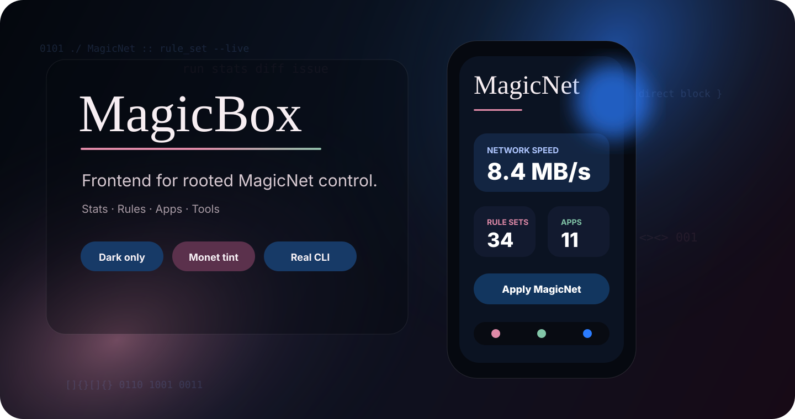
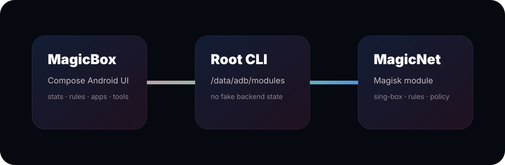
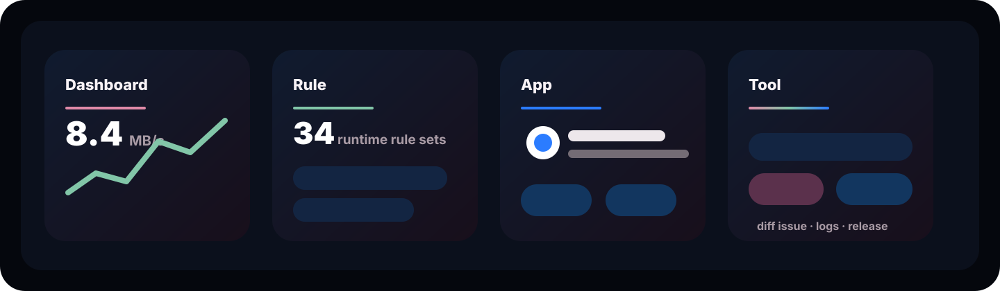

<p align="center">
  
</p>

<div align="center">
  <p><strong>面向日常使用的 Android 代理界面，与 MagicNet 共享可审计的网络核心。</strong></p>
  <p>系统代理 · Root TUN · eBPF · 本地订阅转换 · Token Cloud</p>

  [](https://github.com/LIghtJUNction/MagicBox/releases)
  [](app/build.gradle.kts)
  [](LICENSE)

  [选择版本](#先选择版本) · [连接方式](#三种连接方式) · [导入](#本地导入) · [构建](#构建与验证) · [隐私](PRIVACY_POLICY.md)
</div>

## 先选择版本

MagicBox 从同一份源码构建两个可共存的 APK：

| 版本 | 包名 | 核心在哪里 | 适合谁 |
| --- | --- | --- | --- |
| **MagicBox 通用版** | `com.github.lightjunction.magicbox` | APK 内置 sing-box、Proxylink 适配器与进程监督组件 | 不安装 MagicNet，也希望独立运行系统代理或 Root 数据面 |
| **MagicBox UI** | `com.github.lightjunction.magicbox.ui` | 不携带代理核心；通过 Root 调用已安装的 MagicNet 模块 | 已使用 MagicNet，只需要轻量控制界面 |

通用版包含 `arm64-v8a` 与 `x86_64`，最低 Android 8.0。两个包名不同，可以同时安装，但不要同时启用全设备透明代理，否则会争用路由、DNS、TUN 或端口。

<p align="center">
  
</p>

## 三种连接方式

### 系统代理

```text
应用 / Wi-Fi 手动代理
        ↓
127.0.0.1:2080
        ↓
MagicBox 内置 HTTP / SOCKS 服务
```

不需要 Root，通用版可独立运行。它不是 Android VPN：只有明确使用系统代理或手动填写代理的应用会经过该端口，不能保证接管全部流量。

### TUN

```text
Android 流量 → TUN 设备 → 代理核心 → 目标网络
```

需要 Root 和可用 TUN 设备。界面会检查能力，但“进程存在”不等于数据通道已成功建立；仍需验证 DNS、IPv4/IPv6、局域网、切网、休眠恢复和停止后的路由清理。

### eBPF

eBPF 还要求：

- 当前 sing-box 构建支持对应入站；
- 设备内核具备需要的 eBPF/cgroup 能力；
- attachment、路由和权限检查真实通过。

MagicBox UI 只开放已安装 MagicNet 模块当前公开支持的 TUN/eBPF 控制，不伪造缺失能力。

> [!WARNING]
> Rooted 实机 TUN/eBPF、网络切换和休眠恢复仍属于 Alpha 验收范围。模拟器上的界面、安装和本地 socket 转发测试不能替代真实设备网络验证。

## 本地导入

订阅转换在设备上完成，不把原始订阅交给第三方转换网站。

通用版当前测试样例覆盖：

- 分享链接；
- 标准与 URL-safe Base64；
- Clash / Mihomo YAML；
- sing-box JSON；
- 单节点 JSON 与 Xray JSON；
- SS、VMess、VLESS、Trojan、Hysteria2、AnyTLS、TUIC、SOCKS 与 HTTP。

WireGuard 单 peer 有适配路径。多 peer、脚本钩子和未识别扩展不会静默降级。输入上限为 2 MiB；转换结果还必须通过实际 sing-box 配置检查。

```text
读取输入
   ↓
识别格式与协议
   ↓
生成候选 sing-box 配置
   ↓
安全检查 + sing-box check
   ↓
事务替换现有订阅
```

未知格式、部分转换失败、危险本地文件引用或核心校验失败都会保留旧订阅并明确报错。这里不声称支持所有机场私有格式或所有协议扩展。

UI 版通过 MagicNet 的私有暂存文件与事务接口导入，最终能力由实际安装的模块版本决定。

## Token Cloud 界面

<p align="center">
  
</p>

Token Cloud 不使用玻璃模糊和背景折射。界面由实体表面、留白、字符和清晰层级构成：

- 按钮点击后离散为字符，再汇聚固化；
- 横向拖动可以离散，松手恢复且不触发点击；
- 纵向手势保留正常滚动；
- 粒子池最多 72 个；
- 静止时停止逐帧绘制；
- 支持减少动态效果和省电降级。

视觉效果不能妨碍状态判断：连接、失败、权限、导入来源和停止结果必须优先可读。

## 下载说明

[Releases](https://github.com/LIghtJUNction/MagicBox/releases) 中较早的 `v0.1.2` 是历史 Android 前端发布，早于当前双 flavor / Token Cloud 主线。安装前请阅读具体 Release 说明，不要只根据“latest”假设它包含当前 README 的全部能力。

测试版可能使用 CI 测试签名，后续不同签名的包可能无法覆盖安装。卸载旧测试包前先导出订阅。`release-unsigned.apk` 没有可用于正常升级链的正式签名，不应当作长期发布包。

## 构建与验证

UI 版不需要代理核心即可完成常规开发检查：

```bash
./gradlew :app:testUiDebugUnitTest :app:assembleUiDebug
```

通用版必须先按 [Token Cloud workflow](.github/workflows/token-cloud.yml) 构建并放入原生组件。只更改包名或打出没有核心的空壳 APK，不算通用版。

工作流会围绕同一源码状态验证：

- 两种 APK 的包名、签名与组件隔离；
- 固定版本原生依赖和源码身份；
- Android 35 模拟器共存安装；
- UI 截图与基本交互；
- 实际本地 socket 转发；
- 导入失败时保留旧配置；
- 停止后进程和本地服务退出。

Alpha 发布只提升已经成功验证的同一运行产物，不在发布步骤重新构建，也不上传 unsigned APK 作为正式包。

## 上游与可追溯性

当前源码固定引用：

- MagicNet：`a94682e4a4d2c187b3f2ad7e0107f7d1ad4323cd`
- Proxylink：`44929c0984944870297c260dc43a4aa9262f9e1c`

sing-box 使用 MagicNet 锁定的 LIghtJUNction 分支；eBPF 检查器直接编译对应 MagicNet 源文件。构建产物应同时包含组件许可、来源记录与校验和。

这些提交是源码锚点，不是“所有设备已经验证”的证据。真实能力仍由构建产物、设备内核、Root 环境和逐项运行结果共同决定。

## 目录

```text
app/cloud/                 Android / Compose 适配
app/assets/cloud/          Token Cloud Web 资源
app/universal/             内置核心 flavor
app/ui/                    MagicNet 控制 flavor
native/                    原生组件与构建材料
docs/assets/               README 与架构视觉资产
.github/workflows/         固定依赖、验证与发布流水线
```

更完整的历史说明见 [English docs](docs/README.md) 与 [简体中文文档](docs/README_ZH_HANS.md)。

## License

MagicBox 使用 [AGPL-3.0-or-later](LICENSE)。历史高级管理界面的来源、第三方组件与许可见 [NOTICE.md](NOTICE.md) 和 [ThirdParty.md](docs/ThirdParty.md)。
